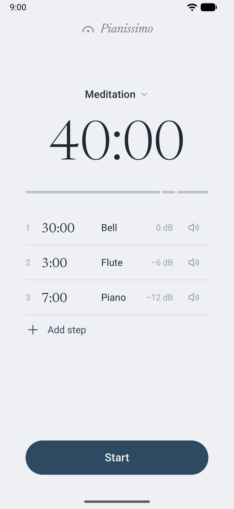
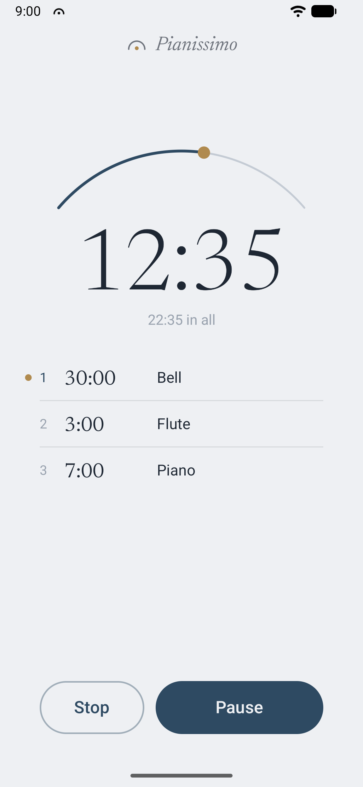
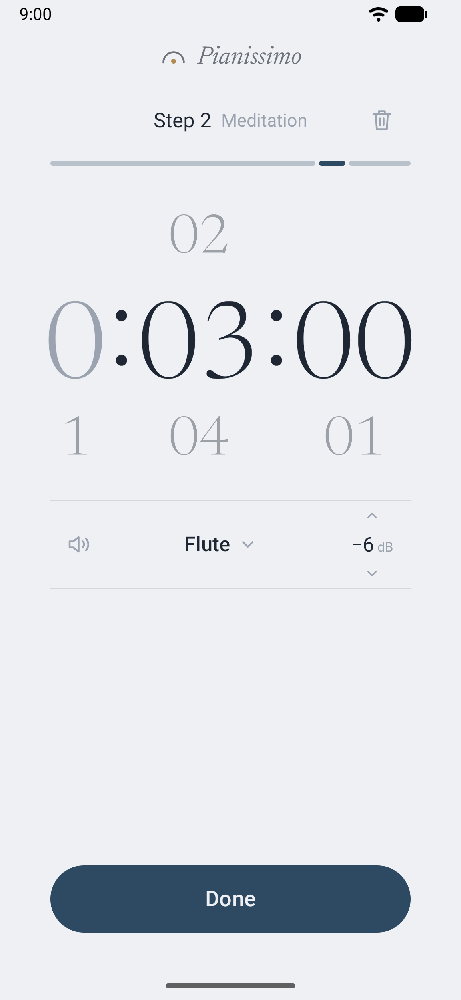
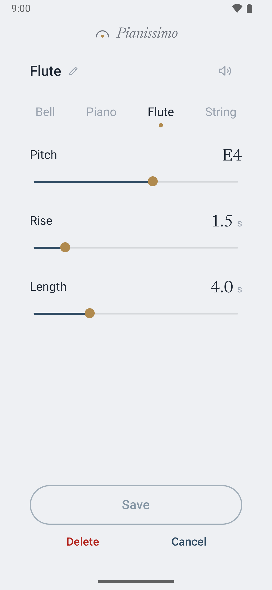

# Pianissimo Timer

A quiet timer for Android. When the time is up, it plays one soft sound and is silent again.

The timer in the Clock app rings loudly and keeps ringing until you pick up the phone. Pianissimo is for
meditation, reading or a nap: times a loud alarm would spoil. The name is the musical marking *pianissimo*:
very quiet.

  
  
  
  

## What it does

- **One soft sound.** It plays once and fades out. There is nothing to turn off.
- **Steps.** A timer can be a chain: 30 minutes, then 3, then 7. Each step has its own sound and loudness.
  Timers are saved under a name.
- **Your own sounds.** Four kinds: bell, piano, flute and string. Set the pitch, the rise and the length of each.
- **It rings on time.** Even with the screen off, the app closed, or Do Not Disturb on.
- **Your volume stays yours.** The sound plays on the alarm volume. The app can only make it quieter and never
  changes a system volume.
- **The time left is in view.** It shows in the status bar. Pause and Stop are in the notification.
- **Nothing else.** No ads, no account, no internet access.

## Install

Requires Android 16 or newer. The app is not on Google Play. Install it from a file:

1. On the phone, download the newest `.apk` from
   [Releases](https://github.com/pybass/pianissimo-timer/releases/latest).
2. Open the file. Android asks to allow installs from the browser or file manager you used; allow it.
3. On first start, allow notifications. Without them the timer still rings, but shows no icon and no time left.

To update, install a newer `.apk` the same way.

Early version: screens, saved timers and sounds may change between releases.

## How it works

The app does not wait for the moment itself: Android may stop or kill the app while the screen is off. On
start the app hands Android one alarm per step with that bell's time. At each time Android wakes the app, even
if it was closed, and it plays the sound. Stop and Pause cancel the alarms; Resume sets new ones.

## Development

Built with Kotlin. Needs `just`, a JDK and the Android SDK (`ANDROID_HOME`). `just` lists the recipes. Emulators
are named by Android version, `16` or `17`, and can run side by side. First run: `just emulator-create 16` once,
`just emulator 16` in its own terminal, then `just app-run 16`. On a phone with USB debugging on:
`just app-run phone`.

- [Spec](docs/spec.md): the rules the app must keep.
- [Rejected](docs/rejected.md): ideas turned down, with the reason for each.

## License

[MIT](LICENSE). The Newsreader font is under the [SIL Open Font License](third_party/Newsreader-OFL.txt).
